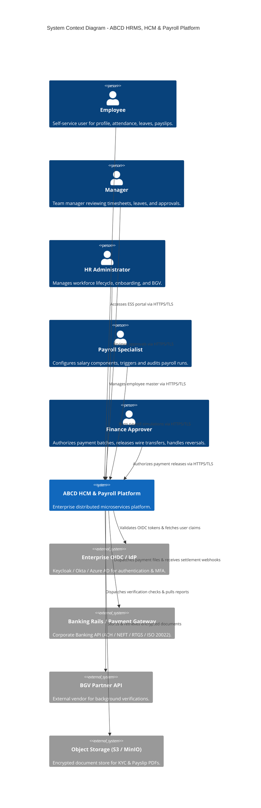
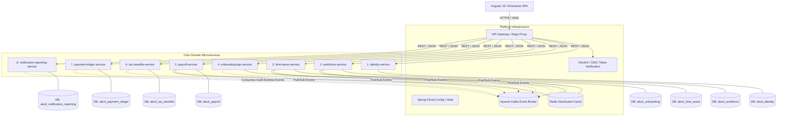
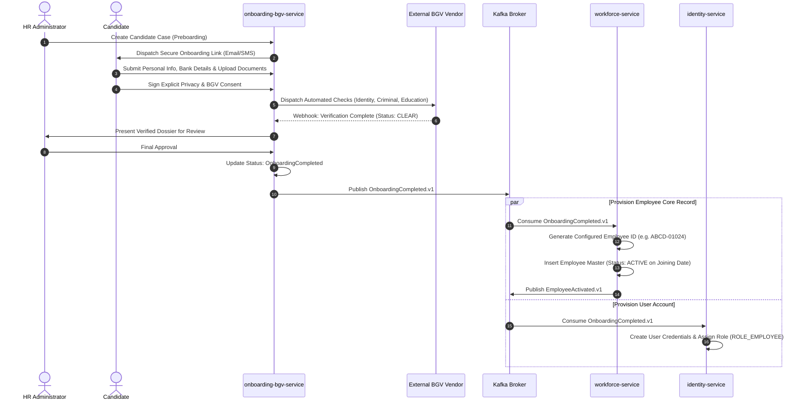
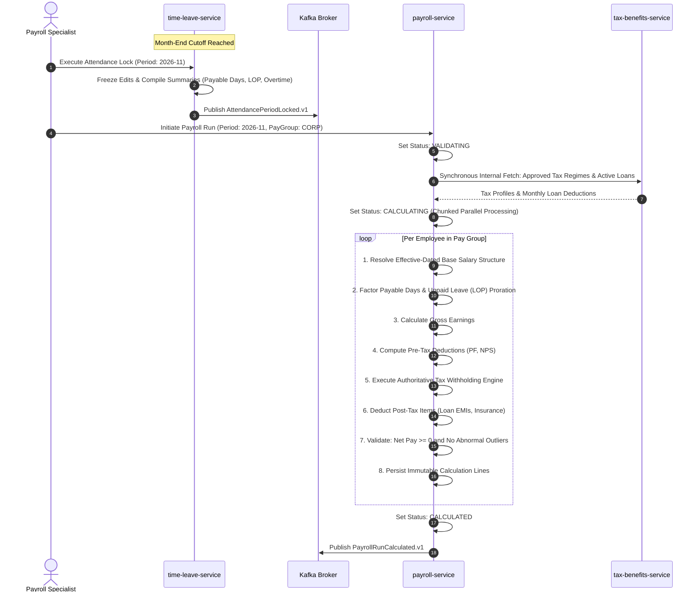
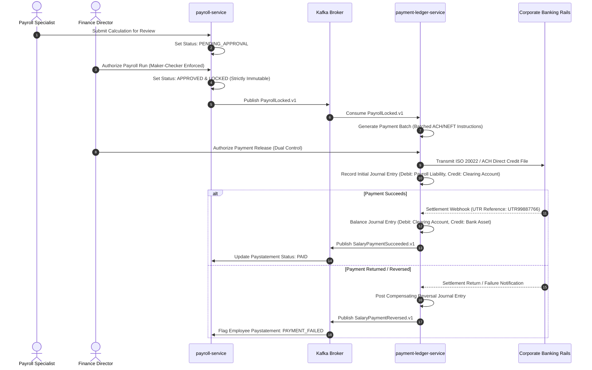
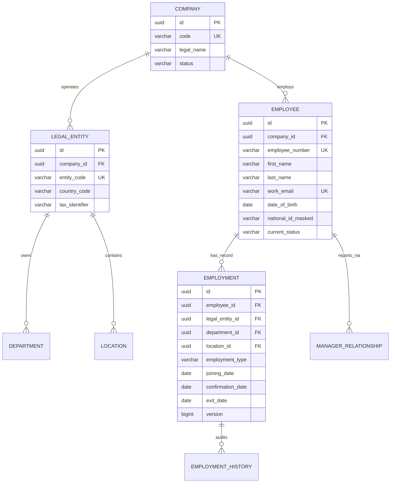
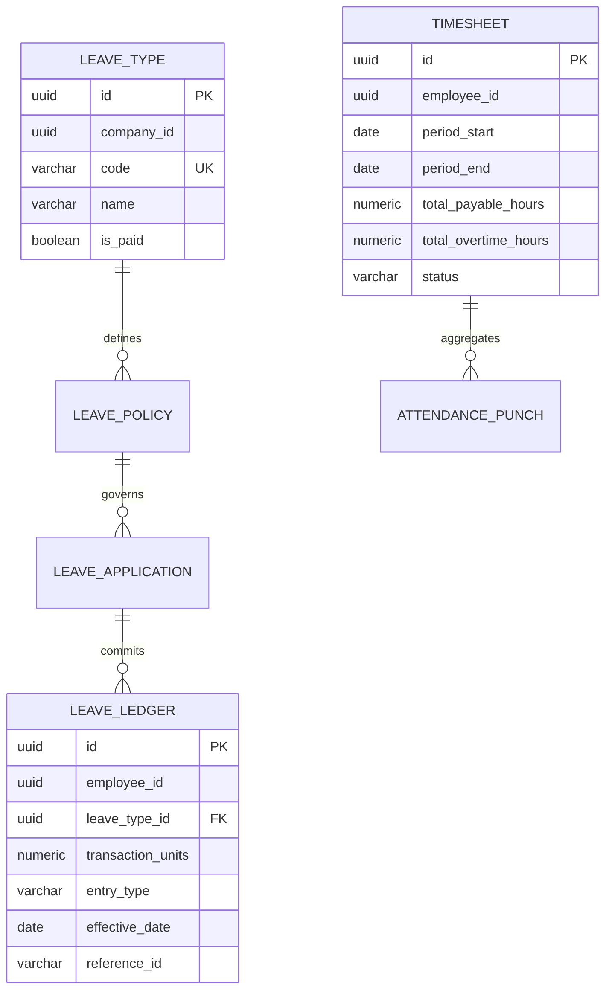
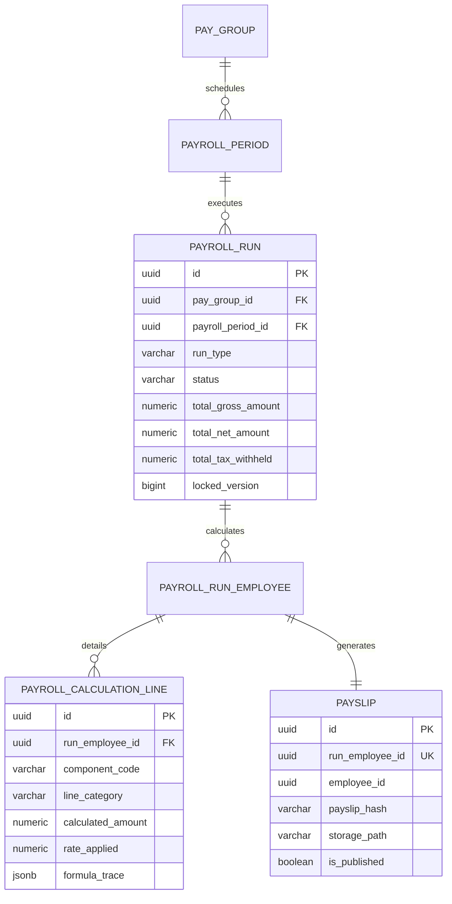
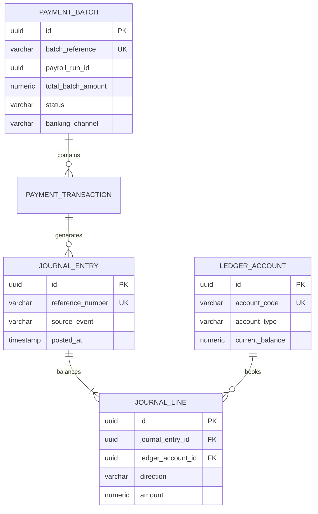

# ABCD Enterprise HRMS, HCM & Payroll Platform — Master Architecture Pack (Deliverable A)

---

## 1. Executive Summary

This document defines the target enterprise architecture for **ABCD**, an extensible Human Capital Management (HCM), Human Resource Management System (HRMS), and Double-Entry Payroll Platform. 

The architecture is structured around **8 domain-driven microservices** built on **Java 11** and **Spring Boot 2.7.18** (pinned LTS release), backed by **PostgreSQL** (schema-per-service isolation), **Apache Kafka** (asynchronous domain events with Transactional Outbox), **Redis** (selective caching), and an enterprise-grade **Angular (v15+ or LTS)** SPA front end.

### Strategic Objectives
1. **Financial Integrity & Immutability:** Absolute separation of payroll calculation from disbursement execution. Double-entry general ledger bookkeeping with balancing enforcement ($\sum \text{Debit} = \sum \text{Credit}$) and zero-drift reconciliation.
2. **Deterministic Calculations:** Calculation engine driven by immutable, effective-dated formulas and jurisdiction rules versioning. Historical payroll runs remain 100% reproducible over time.
3. **Data Isolation & Tenant Security:** Native partitioning and scoped access control by `company_id` and `legal_entity_id`, secured via OAuth2/OIDC stateless JWTs with granular Role-Based and Attribute-Based Access Control (RBAC/ABAC).
4. **Resilience & Eventual Consistency:** Transactional Outbox/Inbox patterns guarantee reliable event publishing without distributed 2-Phase Commit (2PC).

---

## 2. Assumptions, Scope & Open Questions

### 2.1 Baseline Assumptions
* **Jurisdiction (Default Baseline):** India-first statutory baseline (Provident Fund, ESI, Professional Tax, Labour Welfare Fund, Gratuity, Section 192 TDS) modeled entirely as configurable, effective-dated rule engines. *No statutory percentages, thresholds, or slabs are hard-coded in Java.*
* **Base Currency & Money Handling:** Default currency INR (`INR`), multi-currency capable. All monetary values are represented as `NUMERIC(18, 4)` in PostgreSQL and `java.math.BigDecimal` with explicit rounding modes (`RoundingMode.HALF_EVEN` / Banker's Rounding) in Java. Floating-point types (`float`, `double`) are strictly prohibited.
* **Temporal Precision:** All system timestamps are persisted in UTC (`TIMESTAMP WITH TIME ZONE`). Business dates (e.g., payroll period dates, leave dates, birth dates) use ISO-8601 `LocalDate` (`YYYY-MM-DD`).
* **Scale Target:** Designed for 15,000 active employees across 3 legal entities for ABCD in Phase 1, architecturally validated to scale horizontally to 100,000+ employees.
* **Payroll Volume SLO:** Full payroll calculation run for 15,000 employees completed in under 8 minutes via chunked parallel processing.

### 2.2 Framework & Runtime Pinning Analysis
* **Runtime:** Java 11 (Eclipse Temurin 11 JDK).
* **Framework:** Spring Boot `2.7.18` (final patch of the 2.7.x line).
  * *Maintenance/EOL Implication:* Spring Boot 2.7 reached OSS End-of-Life in November 2023. Commercial Spring Enterprise Support or vendor-backed LTS distributions (such as BellSoft Liberica or VMware Tanzu) must be utilized for CVE backports. A phased migration path to Spring Boot 3.x / Java 17+ is planned for future platform iterations.
* **Spring Cloud Train:** `2021.0.9` (fully compatible with Spring Boot 2.7.18 and Java 11).

---

## 3. System Context & Microservices Architecture

### 3.1 Mermaid System Context (C4 Level 1)



### 3.2 Microservice Container & Communications Architecture (C4 Level 2)



---

## 4. Service Boundaries, Responsibilities & Data Ownership

| Service Name | Primary Responsibilities | Direct Database Ownership | Forbidden Responsibilities |
|---|---|---|---|
| **`identity-service`** | Authentication tokens, user credentials mapping, RBAC/ABAC role definitions, MFA enforcement, service-to-service mTLS/JWT identities. | `users`, `roles`, `permissions`, `user_roles`, `service_credentials` | Does NOT store HR employment history, bank details, or personal addresses. |
| **`workforce-service`** | Legal entities, business units, departments, locations, Employee Master, employment lifecycle transitions, reporting tree, headcount analytics. | `company`, `legal_entity`, `business_unit`, `department`, `location`, `employee`, `employment`, `employment_history`, `manager_relationship` | Does NOT compute attendance, evaluate leave days, or calculate salary payout numbers. |
| **`time-leave-service`** | Shifts, rosters, biometric punch ingestion, daily attendance, overtime, timesheet approvals, leave policies, accruals, leave ledger, attendance lock. | `shift`, `calendar`, `attendance_punch`, `daily_attendance`, `timesheet`, `leave_type`, `leave_policy`, `leave_application`, `leave_ledger` | Does NOT process bank files or compute statutory salary deductions. |
| **`onboarding-bgv-service`** | Pre-hire portal, candidate documentation intake, digital consent logs, BGV checks dispatch, manual reviewer workbench, document metadata. | `onboarding_case`, `candidate_document`, `consent_record`, `bgv_case`, `bgv_check_item`, `bgv_vendor_log` | Does NOT store active corporate employee IDs or create live payroll structures. |
| **`payroll-service`** | Payroll calendar & pay groups, effective-dated salary components, gross-to-net calculation pipeline, payroll runs, approval/locking, payslip generator. | `pay_group`, `pay_calendar`, `payroll_period`, `salary_component`, `employee_compensation`, `payroll_run`, `payroll_run_employee`, `payroll_calculation_line`, `payslip` | Does NOT disburse funds directly to banking networks or store physical bank rail ledger states. |
| **`tax-benefits-service`** | Tax declarations, investment proofs, tax regimes (Old vs New), versioned statutory deduction rules (PF/ESI/PT/LWF), company loans & EMI amortization. | `tax_declaration`, `tax_declaration_item`, `tax_rule_version`, `statutory_component_config`, `loan_master`, `loan_installment`, `benefit_enrollment` | Does NOT execute salary disbursements or issue payments. |
| **`payment-ledger-service`** | Payment batch formation, banking rail integrations (ACH/NEFT/ISO 20022), payment reversals, double-entry general ledger, bank reconciliation. | `payment_batch`, `payment_transaction`, `ledger_account`, `journal_entry`, `journal_line`, `bank_reconciliation_record` | Does NOT compute salary lines or alter approved gross-to-net calculations. |
| **`notification-reporting-service`** | Asynchronous email/SMS/push notifications, document generation queue, read-optimized reporting projections (CQRS read models). | `notification_template`, `notification_outbox`, `report_definition`, `report_job_execution`, `read_headcount_summary`, `read_payroll_register` | Does NOT act as authoritative source of truth for HR transactions or financial data. |

---

## 5. Asynchronous Event-Driven Architecture & Kafka Contracts

### 5.1 Event Envelope Specification (`CanonicalEvent<T>`)

Every Kafka domain event is serialized in JSON and validated against a schema registry, encapsulated in a standard envelope:

```json
{
  "eventId": "a9b8c7d6-e5f4-4321-8765-abcdef123456",
  "eventType": "PayrollApproved.v1",
  "schemaVersion": "1.0.0",
  "aggregateType": "PAYROLL_RUN",
  "aggregateId": "run-2026-11-abcd-01",
  "companyId": "comp-abcd-corp",
  "legalEntityId": "le-abcd-technologies-india",
  "occurredAt": "2026-11-02T10:30:00.000Z",
  "producer": "payroll-service",
  "correlationId": "req-9876-4321-0001",
  "causationId": "cmd-approve-run-54321",
  "traceContext": {
    "traceId": "4bf92f3577b34da6a3ce929d0e0e4736",
    "spanId": "00f067aa0ba902b7"
  },
  "payload": {
    "payrollRunId": "b8a8b41e-3a1f-4efc-8d19-e58f28c2c102",
    "payrollPeriodId": "period-2026-11",
    "totalGross": 18500000.0000,
    "totalNet": 14200000.0000,
    "currency": "INR",
    "employeeCount": 1500,
    "approvedBy": "usr-finance-director-01"
  }
}
```

### 5.2 Transactional Outbox Pattern
To prevent dual-write discrepancies between the PostgreSQL database and Apache Kafka:
1. Business mutations and corresponding outbox records are inserted into the same local PostgreSQL transaction:
   ```sql
   INSERT INTO outbox_event (id, aggregate_type, aggregate_id, event_type, payload, status, created_at)
   VALUES (gen_random_uuid(), 'PAYROLL_RUN', 'run-01', 'PayrollApproved.v1', '{...}', 'PENDING', NOW());
   ```
2. A dedicated Outbox Poller (or Debezium CDC engine) reads `PENDING` records, publishes them to Kafka with the `aggregate_id` as the message key (guaranteeing in-order partition delivery), and marks the record as `PUBLISHED`.
3. Consumers implement an **Inbox Pattern** tracking `eventId` in a unique table (`inbox_event`) to guarantee idempotent processing.

---

## 6. End-to-End Workflow State Machines

### 6.1 Employee Onboarding & BGV Workflow



### 6.2 Attendance-to-Payroll Freeze & Calculation Sequence



### 6.3 Payroll Approval, Disbursement & Double-Entry Reversal



---

## 7. Core Data Model & ER Architecture

### 7.1 Cross-Cutting Database Standards
* **Isolation:** Every service manages its own PostgreSQL schema (e.g., `workforce_schema`, `payroll_schema`, `ledger_schema`). Cross-service database joins (`JOIN`) are strictly prohibited.
* **Primary Keys:** UUID v4 (`UUID DEFAULT gen_random_uuid()`) across all entity tables to ensure globally unique identifiers that avoid enumeration exploits.
* **Audit Columns:** Every table contains mandatory audit tracking:
  ```sql
  created_at TIMESTAMP WITH TIME ZONE NOT NULL DEFAULT CURRENT_TIMESTAMP,
  updated_at TIMESTAMP WITH TIME ZONE NOT NULL DEFAULT CURRENT_TIMESTAMP,
  created_by VARCHAR(100) NOT NULL,
  updated_by VARCHAR(100) NOT NULL,
  version BIGINT NOT NULL DEFAULT 0 -- For Hibernate @Version optimistic locking
  ```

### 7.2 Database Entity-Relationship Diagrams (Per Service)

#### Workforce Service (`abcd_workforce`)


#### Time & Leave Service (`abcd_time_leave`)


#### Payroll & Tax Services (`abcd_payroll` & `abcd_tax_benefits`)


#### Payment & Ledger Service (`abcd_payment_ledger`)


---

## 8. Security, Data Privacy & Financial Controls

### 8.1 Threat Model & Mitigations
* **Unauthorized Salary & Financial Record Tampering:**
  * *Mitigation:* Database-level row hash verification (`calculation_line_hash`) and digital signatures on generated paystatements. Separation of duties: The user executing the payroll calculation run (`ROLE_PAYROLL_MAKER`) cannot approve it (`ROLE_PAYROLL_CHECKER`) or release payment (`ROLE_FINANCE_DISBURSER`).
* **Cross-Tenant / Cross-Company Data Leaks:**
  * *Mitigation:* Hibernate `@Filter` applied globally on JPA entities enforcing `company_id = :tenantContextId`. Spring Security Method Security (`@PreAuthorize`) validates JWT claim tenant match against request parameters.
* **PII & Banking Data Exposure:**
  * *Mitigation:* Field-level encryption for National Identification Numbers and Bank Account Numbers using AES-256-GCM. In REST API payloads, bank accounts and national IDs are masked by default (e.g., `XXXX-XXXX-1234`). Full unmasked access requires explicit stepped-up credentials and generates a high-severity audit record.
* **Malicious File Ingestion:**
  * *Mitigation:* Candidate document uploads are staged in an isolated bucket, verified against magic-byte signatures (disallowing executable MIME types), and scanned asynchronously by ClamAV before metadata is registered in `onboarding-bgv-service`.

### 8.2 Double-Entry Bookkeeping Invariant Enforcement
For all financial operations in `payment-ledger-service`, journal balancing is enforced mathematically at the database constraint level and validated in application services before committing:

$$\sum \text{Debit Amounts} - \sum \text{Credit Amounts} = 0.0000$$

Any imbalance raises an immediate unrecoverable `LedgerImbalanceException`, rolling back the entire disbursement transaction.

---

## 9. Performance, Caching & Scalability Patterns

### 9.1 Redis Caching Architecture
* **Strict Source of Truth Invariant:** Redis is strictly an auxiliary read cache. PostgreSQL is the sole authoritative state repository.
* **Target Cache Entities:**
  * Organization structure metadata, holidays, and active pay calendars (`TTL = 24 hours`).
  * Evaluated active salary component formulas and tax rule tables (`TTL = 12 hours`, invalidated immediately via Kafka event `TaxRuleVersionUpdated.v1`).
  * User role-permission mappings (`TTL = 30 minutes`).
* **Cache Key Partitioning:** Keys are strictly namespace-scoped:  
  `abcd:tenant:{companyId}:workforce:orgtree`  
  `abcd:tenant:{companyId}:payroll:rules:{versionId}`
* **Cache Stampede Prevention:** Use Redisson distributed read/write locks when loading expensive organization hierarchy trees.

### 9.2 High-Throughput Payroll Parallel Processing
To calculate payroll for 15,000+ employees in minutes without transaction timeouts or memory leaks:
1. The payroll period is split into logical partitions (e.g., batches of 250 employees per worker chunk).
2. Processing chunks are distributed across a thread pool utilizing Spring Batch / virtual work partitions.
3. Hibernate sessions are flushed and cleared (`entityManager.clear()`) after every 100 employee records to prevent Out-Of-Memory (OOM) heap bloat.

---

## 10. Front-End Architecture: Enterprise Angular SPA

### 10.1 UI Architecture Overview
* **Framework:** Angular 15+ (TypeScript, Strict Mode enabled).
* **Architecture:** Enterprise Modular Workspace with NgRx ComponentStore / State Management.
* **Design System:** Angular Material / Tailwind CSS styled according to ABCD enterprise branding.
* **Security:** OpenID Connect (OIDC) client via `angular-oauth2-oidc` handling silent token refresh via HTTP-only storage patterns. Centralized HTTP Interceptors attach Bearer JWTs and append unique `X-Correlation-Id` and `Idempotency-Key` headers on all command requests.

### 10.2 Angular Workspace Layout
```text
abcd-hrms-ui/
├── src/
│   ├── app/
│   │   ├── core/                    # Singleton services, interceptors, guards
│   │   │   ├── auth/                # OAuth2 OIDC auth service & guards
│   │   │   ├── http/                # ApiHttpInterceptor, ErrorInterceptor
│   │   │   └── state/               # Global session & tenant context store
│   │   ├── shared/                  # Reusable components, pipes, directives
│   │   │   ├── components/          # DataTable, StatusBadge, ConfirmDialog
│   │   │   └── pipes/               # CurrencyFormatterPipe, MaskedDataPipe
│   │   └── modules/                 # Feature modules (Lazy-Loaded)
│   │       ├── employee-self-service/ # Profile, Leaves, Punch, Payslips
│   │       ├── manager-hub/         # Team approvals, timesheets
│   │       ├── workforce-admin/     # Employee master, org chart, headcount
│   │       ├── onboarding-portal/   # Candidate intake & document verification
│   │       ├── payroll-console/     # Payroll runs, simulations, lock, payslips
│   │       ├── finance-ledger/      # Disbursement batches, reconciliation
│   │       └── system-config/       # Salary rules, tax slabs, pay calendars
```

### 10.3 Angular UI Role-to-Feature Navigation Matrix

| Portal Area | Target Role | Primary Capabilities |
|---|---|---|
| **Employee Self-Service (ESS)** | `ROLE_EMPLOYEE` | View personal profile, submit clock-in/out, apply for leaves, view leave balance ledger, download digital payslips, declare income tax exemptions. |
| **Manager Hub** | `ROLE_MANAGER` | View direct report directory, review/approve leave requests, approve weekly timesheets, monitor attendance regularizations. |
| **HR Administration** | `ROLE_HR_ADMIN` | Create new hires, initiate BGV workflows, manage employee status transitions (confirm, transfer, terminate), access headcount dashboards. |
| **Payroll Workbench** | `ROLE_PAYROLL_MAKER`, `ROLE_PAYROLL_CHECKER` | Set up salary components, run monthly payroll preview simulations, view anomaly exception reports, submit runs for review, lock payroll. |
| **Finance & Treasury Console** | `ROLE_FINANCE_DIRECTOR` | Release locked payment batches, upload bank settlement clearing files, trigger payment reversals, review balanced general ledger journals. |

---

## 11. Multi-Module Project & Repository Structure

```text
abcd-hrms/
├── pom.xml                               # Root POM with pinned dependency management
├── docker-compose.yml                    # Local multi-service infrastructure orchestration
├── .env.example                          # Secret placeholders template
├── platform/
│   ├── platform-bom/                     # Pinned BOM (Spring Boot 2.7.18, Java 11)
│   ├── common-core/                      # Base DTOs, Money utilities, Exceptions
│   ├── common-security/                  # JWT parser, ABAC evaluator, field masking
│   ├── common-messaging/                 # Kafka envelope, Outbox/Inbox models
│   └── common-observability/             # Micrometer, Zipkin/Brave, Logstash formatters
├── identity-service/                     # Port 8081
├── workforce-service/                    # Port 8082
├── time-leave-service/                   # Port 8083
├── onboarding-bgv-service/               # Port 8084
├── payroll-service/                      # Port 8085
├── tax-benefits-service/                 # Port 8086
├── payment-ledger-service/               # Port 8087
├── notification-reporting-service/       # Port 8088
└── abcd-hrms-ui/                         # Angular 15+ Enterprise SPA
```

---

## 12. Phased Implementation Roadmap

Following review and approval of this Architecture Pack, implementation proceeds strictly in sequenced phases:

* **Phase 1: Foundation & Shared Platform:** Root POM, Maven multi-module structure, Docker Compose (PostgreSQL, Kafka, Redis, Zookeeper), `common-messaging` (Transactional Outbox), and `common-security` (OAuth2 JWT verification).
* **Phase 2: Identity & Workforce Management:** `identity-service` & `workforce-service` data models, Flyway DDLs, Employee Master APIs, and Organization Tree hierarchy.
* **Phase 3: Time, Attendance & Leave Ledger:** Ingestion of attendance punches, timesheet approvals, and immutable leave ledger with accrual calculations.
* **Phase 4: Candidate Onboarding & BGV Service:** Candidate document intake portal, privacy consent logs, and BGV verification state machine.
* **Phase 5: Payroll & Statutory Tax Calculation Engine:** Implementation of effective-dated compensation structures, tax projection algorithms, chunked gross-to-net engine, and payslip generator.
* **Phase 6: Payment Batches, Double-Entry Ledger & Reversals:** Disbursement file generators, bank settlement webhook consumers, double-entry ledger invariant engine, and compensating reversal sagas.
* **Phase 7: Angular Enterprise UI Implementation:** Component library, OIDC state guards, Employee Self-Service, Manager Hub, and Payroll Console screens.
* **Phase 8: End-to-End Integration, Observability & Hardening:** Testcontainers integration suite, simulated concurrent 15,000-employee payroll stress tests, distributed tracing, and production runbooks.

---

## 13. Architectural Decision Records (ADRs)

* **ADR-001: Java 11 & Spring Boot 2.7.18 Baseline:** Mandatory enterprise compliance constraint. Code strictly adheres to Java 11 bytecode compatibility. Explicit BOM overrides guarantee zero leakage of Java 17+ APIs.
* **ADR-002: Rejection of Distributed 2-Phase Commit (2PC):** Cross-service consistency relies exclusively on the **Transactional Outbox Pattern** and **Saga Orchestration** with compensating transactions.
* **ADR-003: Double-Entry Immutable General Ledger:** Reversals and adjustments never overwrite previous financial transactions. A failed or returned payment generates a balancing compensating entry.
* **ADR-004: Calculation Isolation:** Payroll calculations never pull live live mutable data during execution. Calculation runs freeze all inputs into an immutable snapshot before processing.

---
*End of Deliverable A. Please confirm approval of this Architecture Pack to proceed to Deliverable B (Database Schemas & Flyway DDLs) and Deliverable C/D (Runnable Foundation & Phased Service Implementation).*